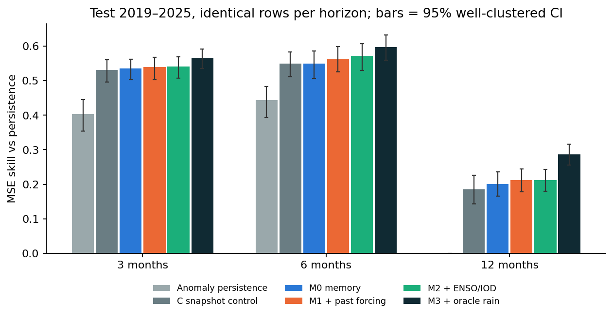
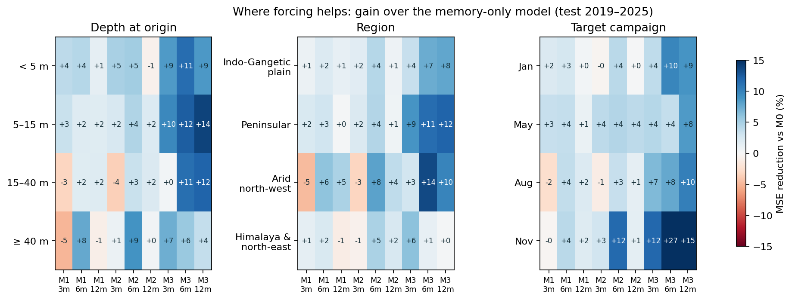
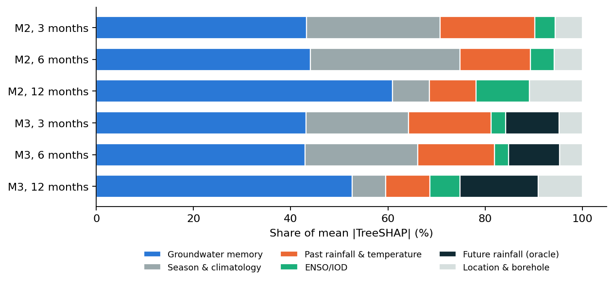

# 08 — Phase 2: Skill Decomposition (RQ1)

**Question.** How much forecast skill does monsoon forcing add over groundwater memory alone,
and at which horizons, depths, regions and seasons?

Reproduce:

```bash
conda activate anpr
python -m src.research.skill_decomposition   # arms M0–M3 + control C  (~15 min, 16 cores)
python -m src.research.reference_models      # Random Forest + Chronos-2 (GPU)
python -m src.research.skill_robustness      # alternative split + spatial blocks
python -m src.research.skill_figures         # figures in reports/skill/
```

## 1. Design

| Arm | Features | What it answers |
|---|---|---|
| **M0 memory** | depth, 4 lags, changes, season, expanding climatology, location, borehole depth | The pilot model |
| **M1 + past forcing** | M0 + rain since the last campaign, rain over 3/6/12 months, last JJAS total and ratio, SPI-3/6/12, temperature anomaly | Value of *observed* weather |
| **M2 + ENSO/IOD** | M1 + Niño 3.4 and DMI at 0/3/6-month lags | Value of large-scale climate state |
| **M3 + oracle rain** | M2 + rain that actually fell between origin and target | Upper bound: the value of a perfect rainfall forecast |
| **C snapshot control** | M0 + the source file's observation-day rainfall summed over 2/4/8 campaigns | Reproduces prior work's construction |

- All arms are trained and scored on **identical rows**. Test = target years 2019–2025, restricted
  to rows where every baseline exists (25 340 / 24 073 / 32 472 rows at 3 / 6 / 12 months).
- Each arm gets the same search: 6 settings (depth 4/6/8 × min-child-weight 5/20), early-stopped
  on the inner block 2013–2015, then refitted on all training years ≤ 2015 with proportionally more trees.
- Uncertainty is reported in four ways, because they answer different questions:
  1. **Well-clustered bootstrap** (1 000 draws) — CIs over the population of wells.
  2. **Diebold–Mariano** on campaign-averaged loss differentials (Newey–West) — accounts for
     common shocks within a campaign; T = 24–25 campaigns, so power is low.
  3. **Campaign sign test** — in how many test campaigns does the richer arm have lower MAE?
  4. **Sensitivity without datum jumps** — see §3.

## 2. Results

### Skill vs persistence (95 % well-clustered CI)

| Arm | 3 months | 6 months | 12 months |
|---|---|---|---|
| Anomaly persistence | +0.404 [0.354, 0.446] | +0.444 [0.393, 0.484] | 0.000 |
| C snapshot control | +0.531 [0.496, 0.561] | +0.550 [0.512, 0.584] | +0.185 [0.143, 0.226] |
| M0 memory | +0.536 [0.503, 0.563] | +0.549 [0.506, 0.586] | +0.201 [0.166, 0.235] |
| M1 + past forcing | +0.539 [0.503, 0.568] | +0.564 [0.526, 0.598] | +0.212 [0.179, 0.244] |
| M2 + ENSO/IOD | +0.541 [0.507, 0.569] | **+0.572** [0.529, 0.608] | +0.212 [0.179, 0.243] |
| M3 + oracle rain | +0.566 [0.536, 0.592] | +0.598 [0.559, 0.633] | +0.287 [0.256, 0.316] |

Median per-well NSE: M0 0.31 / 0.09 / 0.11 → M2 0.34 / 0.14 / 0.13 → M3 0.38 / 0.22 / 0.23.



### Gains between arms

| Comparison | Horizon | MSE reduction [CI] | MAE reduction [CI] | Campaigns better | Sign-test p |
|---|---|---|---|---|---|
| M1 vs M0 (past forcing) | 3 mo | +0.7 % [−1.4, 2.9] | +1.2 % [0.6, 1.8] | 13 / 24 | 0.84 |
| | 6 mo | +3.3 % [1.4, 5.1] | +1.5 % [1.0, 2.0] | 19 / 24 | 0.007 |
| | 12 mo | +1.3 % [−0.2, 2.9] | +1.9 % [1.5, 2.2] | 22 / 25 | 0.0002 |
| M2 vs M0 (forcing + ENSO/IOD) | 3 mo | +1.1 % [−0.4, 2.7] | +2.0 % [1.4, 2.6] | 16 / 24 | 0.15 |
| | 6 mo | **+5.0 % [3.3, 6.8]** | **+3.6 % [3.1, 4.0]** | **22 / 24** | **4 × 10⁻⁵** |
| | 12 mo | +1.3 % [−0.1, 2.9] | +1.5 % [1.1, 2.0] | 17 / 25 | 0.11 |
| M3 vs M2 (oracle future rain) | 3 mo | +5.5 % [4.0, 7.0] | +3.4 % [2.9, 3.9] | 19 / 24 | 0.007 |
| | 6 mo | +6.1 % [2.8, 8.7] | +4.2 % [3.5, 4.8] | 15 / 24 | 0.31 |
| | 12 mo | +9.6 % [7.7, 11.4] | +6.5 % [5.8, 7.1] | 20 / 25 | 0.004 |
| C vs M0 (snapshot rainfall) | 3 mo | −1.0 % [−2.6, 0.5] | −0.5 % [−0.9, −0.1] | 10 / 24 | 0.54 |
| | 6 mo | +0.2 % [−2.1, 2.4] | +0.5 % [0.0, 0.9] | 14 / 24 | 0.54 |
| | 12 mo | −2.1 % [−4.0, −0.1] | +0.1 % [−0.2, 0.5] | 12 / 25 | 1.00 |

Full table including DM statistics: `reports/skill/diebold_mariano.csv`.

### Where forcing helps



- **The monsoon-spanning forecast gains most.** For a November target, M2 cuts MSE by 12 % at
  6 months (May → November) and the oracle by 27 %. January/May targets gain little.
- **Shallow and mid-depth wells (< 15 m)** gain consistently; for 15–40 m and ≥ 40 m wells past
  forcing slightly hurts at 3 months (−3 to −5 %), consistent with slower, damped responses.
- **Peninsular hard-rock and arid north-west** wells gain most from the oracle (+11 to +14 % at
  6 months); Himalaya & north-east gain least (small sample, 600–840 rows).

### Attribution (grouped TreeSHAP)



At 12 months ENSO/IOD receives 11 % of the attribution in M2 yet adds no skill (M2 vs M1:
−0.0 % MSE). Attribution share is not evidence of predictive value; the nested-arm comparison is.

## 3. Datum jumps and the choice of test

The 0.1 % largest squared errors (≈ 30 readings per horizon) carry 15–16 % of total squared error.
They are single-reading level jumps such as 69.8 → 6.9 m in one quarter at wells measured once
per campaign — most likely datum changes, replaced wells or pumping-level readings, not
forecastable hydrology. They stay in every headline number. Consequences:

- The squared-error DM test is dominated by 1–2 campaigns and has p > 0.2 even where 19 of 24
  campaigns improve. The absolute-loss DM is more robust but still low-powered at T = 24.
- The **campaign sign test** is used as the primary campaign-level evidence; MAE CIs as the
  primary well-level evidence; MSE without |Δ| > 20 m jumps as a sensitivity check
  (gains mostly hold or grow, e.g. M3 vs M2 at 12 months +9.6 → +10.3 %, M1 vs M0 at 12 months
  +1.3 → +3.1 %; the exception is M2 vs M1 at 3 months, +0.4 → −0.5 %).

## 4. Reference models

Scored on all test rows where anomaly persistence exists (31 468 / 30 424 / 32 472 rows), so the
XGBoost numbers differ slightly from §2. Chronos-2 (`amazon/chronos-2`, 120 M parameters) sees each
well's campaign series up to the origin (≤ 32 years, gaps as NaN) and forecasts 4 campaigns ahead.

| Model | Skill 3 mo | Skill 6 mo | Skill 12 mo | MAE 3 / 6 / 12 mo (m) |
|---|---|---|---|---|
| Chronos-2 zero-shot | +0.403 | +0.490 | +0.129 | 1.51 / 1.75 / 1.67 |
| Chronos-2 + past rain | +0.461 | +0.539 | +0.158 | 1.42 / 1.62 / 1.62 |
| Chronos-2 + future rain (oracle) | +0.495 | +0.582 | +0.222 | 1.37 / 1.52 / 1.54 |
| Random Forest M0 | +0.515 | +0.561 | +0.207 | 1.39 / 1.63 / 1.64 |
| Random Forest M2 | +0.510 | +0.561 | +0.218 | 1.39 / 1.64 / 1.62 |
| XGBoost M0 | +0.506 | +0.554 | +0.201 | 1.42 / 1.67 / 1.65 |
| XGBoost M2 | +0.511 | +0.572 | +0.212 | 1.40 / 1.63 / 1.62 |
| XGBoost M3 (oracle) | +0.540 | +0.598 | +0.287 | 1.35 / 1.56 / 1.52 |

- **Zero-shot Chronos-2 trails the trained global models** at every horizon, unlike the
  Korean daily-well study (Kim et al. 2026). Quarterly, gappy series give it short contexts.
- **Rain matters more to Chronos-2 than to the tree models.** Past rain as a covariate cuts its MAE
  by 6–7 % at 3–6 months; the oracle by a further 3–6 %. The trees already encode seasonality
  through the expanding climatology features, so less is left for rain to explain.
- **Random Forest ≈ XGBoost**, but RF gains nothing from forcing at 3–6 months. The size of the
  forcing gain is model-dependent, which the paper must state.
- N-HiTS was not run: on quarterly series with median 9 years of record it has too little context
  per well; Chronos-2 covers the neural-forecaster comparison.

## 5. Robustness

Same tuning procedure; MSE / MAE reduction and campaign sign test (`reports/skill/robustness.csv`).

| Comparison | Setting | 3 mo | 6 mo | 12 mo |
|---|---|---|---|---|
| **M2 vs M0** | Main (test 2019–25) | +1.1 % / +2.0 % (16/24) | **+5.0 % / +3.6 % (22/24)** | +1.3 % / +1.5 % (17/25) |
| | Train ≤ 2017, test 2020–25 | +3.0 % / +2.0 % (14/20) | **+3.1 % / +2.2 % (16/20)** | +5.7 % / +4.2 % (16/21) |
| | Spatial blocks (unseen regions) | +2.0 % / +2.4 % (19/24) | **+3.7 % / +2.2 % (19/24)** | +1.0 % / +0.8 % (12/25) |
| M1 vs M0 | Main | +0.7 % / +1.2 % | +3.3 % / +1.5 % | +1.3 % / +1.9 % |
| | Train ≤ 2017 | +2.8 % / +1.3 % | +1.8 % / +0.8 % | +2.7 % / +1.4 % |
| | Spatial blocks | +0.2 % / +1.3 % | +2.2 % / +1.4 % | −1.4 % / −0.3 % |
| **M3 vs M2** (oracle headroom) | Main | +5.5 % / +3.4 % | +6.1 % / +4.2 % | +9.6 % / +6.5 % |
| | Train ≤ 2017 | +2.8 % / +2.4 % | +5.2 % / +4.9 % | +9.3 % / +6.4 % |
| | Spatial blocks | +2.5 % / +2.3 % | +5.9 % / +5.2 % | +5.5 % / +5.2 % (22/25) |

Cells: MSE reduction / MAE reduction (campaigns better / campaigns). Not done: CHIRPS as an
alternative rainfall product (IMD passed every sanity check; deferred to revision if a reviewer asks).

## 6. Answer to RQ1

1. **Groundwater memory carries most of the skill.** The memory-only global model removes
   54–55 % of persistence's squared error at 3–6 months and 20 % at 12 months.
2. **Observed forcing adds a small but reliable gain, largest at 6 months.** Past IMD rainfall plus
   ENSO/IOD (M2) improves on memory alone in all 9 horizon × setting combinations, by 1–6 % MSE
   and 1–4 % MAE. At 6 months it improves in 16–22 of 20–24 test campaigns in every setting
   (sign test p ≤ 0.012). Rainfall alone (M1) is smaller and not robust in unseen regions at 12 months.
3. **The gain is physical:** it concentrates in the forecast that spans the monsoon (May → November
   target, +12 % MSE) and in shallow and mid-depth wells (< 15 m).
4. **A perfect rainfall forecast would add 5.5–9.6 % more in the main test, and at least 2.5 % in every robustness setting**, growing with horizon.
   This is the headroom a skilful seasonal monsoon forecast could unlock (Phase 4 values it).
5. **The source file's snapshot rainfall adds nothing** (−2.1 to +0.2 % MSE), reproducing prior
   work's "climate does not help" result. That null came from the feature construction, not the hydrology.
6. **Model choice matters for the size of the gain:** Random Forest gains less from forcing, while
   zero-shot Chronos-2 gains 6–7 % MAE from the same rain but stays below the trained models.

**Exit check (Phase 2):** met. Every arm × horizon has CIs (§2), and the answer above holds under an
alternative split and spatially blocked validation (§5).
