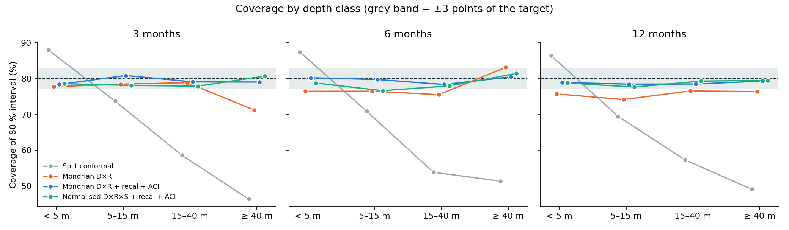
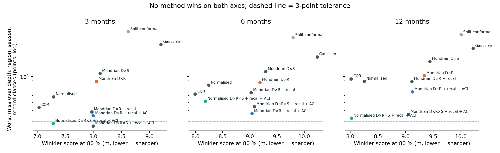
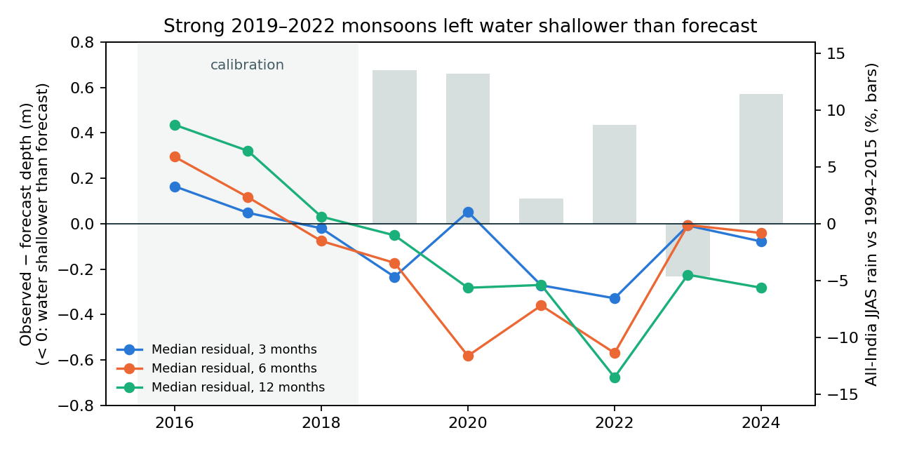
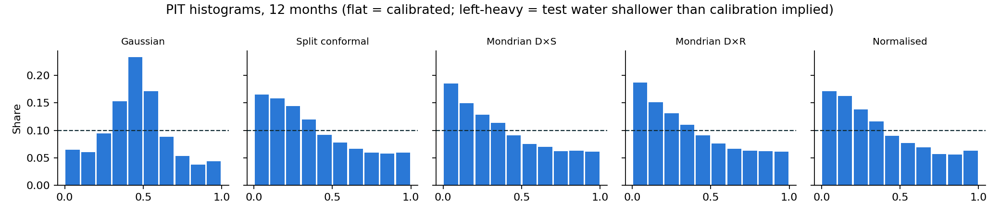

# 09 — Phase 3: Uncertainty Calibration (RQ2)

**Question.** Can forecast intervals hold their stated coverage for shallow and deep wells, every
region and every season — and keep holding when the climate regime shifts?

Reproduce (needs Phase 2 outputs):

```bash
conda activate anpr
python -m src.research.calibration          # ~2 min, 16 cores
python -m src.research.calibration_figures  # figures in reports/calibration/
```

## 1. Design

- **Point forecast:** the Phase 2 M2 arm (memory + past forcing + ENSO/IOD), trained ≤ 2015.
- **Calibration residuals:** target years 2016–2018 (27 477 / 27 086 / 26 603 rows at 3 / 6 / 12 months).
- **Test:** 2019–2025, every test row with an M2 forecast (32 869 / 31 548 / 33 091 rows).
- **Levels:** 50, 80, 90, 95 %. Conditional coverage is checked by depth class, region, target season
  and record length, with a binomial test per class and Holm correction.
- **Conformal intervals** are two-sided from signed residuals with finite-sample ranks. A cell with
  fewer than 50 calibration residuals falls back to its parent (e.g. depth × region → depth → all).

| Method | Calibrated on | Planned in advance? |
|---|---|---|
| Gaussian | ± z·σ of calibration residuals | yes |
| Split conformal | one pool for every well | yes |
| Mondrian D×S | pools per depth class × target season (the pilot method) | yes |
| Mondrian D×R | pools per depth class × region | yes |
| Normalised | residual / σ̂(x); σ̂ cross-fitted by well on calibration rows | yes |
| CQR | quantile XGBoost on M2 features, conformalised | yes |
| Mondrian D×R + recal | D×R pools growing with test residuals already observed (target ≤ T − h) | yes |
| **Mondrian D×R + recal + ACI** | plus adaptive conformal inference per cell, γ = 0.05 fixed a priori | **yes — primary** |
| Mondrian D×R×S + recal + ACI | season added to the cells | **no — added after seeing season misses** |
| Normalised D×R×S + recal + ACI | σ̂-scaled scores in the same online scheme | **no — added after seeing results** |

The online methods only use readings that would have been available when each forecast was issued
(a unit test checks that a residual at target T cannot affect any interval before T + h).

## 2. Results

### Overall coverage (%)

| Method | 80 %: 3 / 6 / 12 mo | 90 %: 3 / 6 / 12 mo | Median width at 80 % (m) |
|---|---|---|---|
| Gaussian | 90.0 / 89.5 / 89.2 | 93.6 / 93.5 / 93.3 | 6.42 / 7.19 / 7.13 |
| Split conformal | 80.2 / 78.3 / 77.5 | 90.1 / 88.9 / 88.5 | 4.20 / 4.76 / 4.80 |
| Mondrian D×S | 78.0 / 76.7 / 75.4 | 88.3 / 87.5 / 87.3 | 3.42 / 3.86 / 3.66 |
| Mondrian D×R | 78.0 / 76.5 / 75.2 | 88.3 / 87.3 / 87.0 | 2.86 / 3.39 / 3.55 |
| Normalised | 78.0 / 77.2 / 76.6 | 88.3 / 88.4 / 88.1 | 3.34 / 3.99 / 3.90 |
| CQR | 80.5 / 79.5 / 80.3 | 89.9 / 89.1 / 90.0 | 3.43 / 4.05 / 3.99 |
| Mondrian D×R + recal | 78.9 / 77.9 / 77.0 | 89.1 / 88.4 / 88.1 | 2.90 / 3.43 / 3.55 |
| **Mondrian D×R + recal + ACI** | **79.3 / 79.9 / 78.7** | **89.4 / 89.5 / 88.4** | 2.90 / 4.21 / 4.06 |
| Mondrian D×R×S + recal + ACI | 78.6 / 77.9 / 77.5 | — | 3.46 / 4.47 / 4.01 |
| Normalised D×R×S + recal + ACI | 78.4 / 78.0 / 78.4 | — | 3.36 / 3.99 / 3.93 |

The Gaussian interval over-covers by ten points because the datum jumps (docs/08 §3) inflate σ.

### Conditional coverage — the headline



Worst |coverage − nominal| over the **depth and region** classes, at 80 % and 90 % (points):

| Method | 3 mo | 6 mo | 12 mo |
|---|---|---|---|
| Split conformal | 33.6 | 28.6 | 30.9 |
| Gaussian | 26.2 | 19.3 | 21.4 |
| Mondrian D×S | 10.9 | 11.4 | 15.1 |
| CQR | 4.4 | 6.2 | 9.4 |
| Mondrian D×R | 8.8 | 4.9 | 5.8 |
| Normalised | 6.2 | 7.1 | 8.8 |
| Mondrian D×R + recal | 2.3 | 2.9 | 4.0 |
| **Mondrian D×R + recal + ACI** | **1.6** | **1.7** | **3.0** |
| Mondrian D×R×S + recal + ACI | 2.6 | 2.9 | 3.6 |
| Normalised D×R×S + recal + ACI | 2.1 | 3.6 | 3.3 |

- A single interval width covers **88 % of readings in wells < 5 m but 46–51 % in wells ≥ 40 m**.
- Static Mondrian pools fix most of this; ACI with rolling recalibration brings every depth class to
  78.3–80.9 % at 80 % on every horizon.
- Adding season to the cells fixes the remaining season misses (D×R + ACI: August targets at 12 months
  73.4 %; D×R×S + ACI: 77.6 %) at the cost of slightly worse region coverage.

### Sharpness vs conditional coverage



No method wins on both axes. CQR and the normalised online method give the sharpest intervals
(Winkler at 80 %, 12 months: 8.02 m each vs 9.12 m for D×R + ACI). The normalised online method
also narrows deep-well intervals (≥ 40 m, 3 months: 9.8 m vs 11.7 m) while keeping every class within
2–5 points. CRPS of the static predictive distributions: normalised 1.09 / 1.26 / 1.28 m beats
Mondrian D×R 1.13 / 1.31 / 1.33, split 1.15 / 1.34 / 1.36 and Gaussian 1.21 / 1.38 / 1.37.

## 3. Why static calibration drifts (step 3.3)



The calibration years 2016–2018 followed the 2014–15 droughts (all-India JJAS 0 to −6 %); residuals
were positive (water deeper than forecast, 12-month median +0.03 to +0.44 m). The test opened with
strong monsoons (2019 +14 %, 2020 +13 %, 2022 +9 %): water tables came in shallower than forecast
(12-month median down to −0.68 m in 2022; 73 % of readings shallower than forecast). Static intervals
calibrated in the drier regime therefore under-cover on the shallow side — visible as left-heavy PIT
histograms — and miss nominal by 2–5 points overall. Rolling recalibration plus ACI absorbs the shift.



## 4. Formal tests and sensitivity

- **Binomial tests (Holm-corrected)** reject nominal coverage in many classes for every method,
  including ACI (88 of 180 class × level × horizon cells). With up to 22 000 readings per class (smallest: 854) even a
  1–2 point deviation is "significant", and readings are spatially and temporally correlated, so the
  test is anti-conservative. The ±3-point tolerance is the practical criterion.
- **ACI step size γ** (worst depth/region miss at 80 % and 90 %, points): γ = 0.01 → 3.72,
  0.02 → 3.61, **0.05 → 3.02**, 0.10 → 2.67. Larger γ tracks drift faster but widens intervals
  (median width at 80 %, 12 months: 3.55 → 4.92 m).

## 5. Answer to RQ2 and exit check

1. **A single interval for all wells fails badly by depth:** 80 % intervals cover 88 % of shallow-well
   readings and under 50 % of deep-well readings. Gaussian intervals over-cover overall and still fail by depth.
2. **Calibrating separately per depth × region fixes most of it**, but static calibration drifts under a
   monsoon regime shift: 2019–2022 were wetter than the calibration years, so water came in shallower than forecast.
3. **Rolling recalibration + adaptive conformal inference (ACI) keeps every depth and region class within
   1.6–3.0 points of nominal** at 80 % and 90 % on all three horizons, using only data available at forecast time.
4. **Sharper alternatives exist:** CQR and the normalised online method cut the Winkler score by ~12 % but
   miss individual classes by up to 9.4 and 5.1 points respectively.

**Exit check (Phase 3):** met with one marginal exception. The pre-registered method (Mondrian D×R + recal +
ACI, γ = 0.05) keeps all depth and region classes within ±3 points except Himalaya & north-east at
12 months / 80 %: 83.02 % (+3.02 points, the conservative side, n = 854, Holm p = 0.23). γ was not re-tuned
on the test period to remove it.

## 6. Artefacts

| File | Content |
|---|---|
| `src/research/calibration.py` | All methods, evaluation, tests of conditional coverage |
| `src/research/calibration_figures.py` | Four figures |
| `tests/research/test_calibration.py` | 8 tests incl. the no-look-ahead test for online methods |
| `reports/calibration/coverage.csv` | Coverage, width, Winkler, binomial/Holm p per method × level × horizon × class |
| `reports/calibration/probabilistic.csv` | CRPS overall and by depth/region |
| `reports/calibration/aci_gamma_sensitivity.csv` | ACI γ sweep |
| `reports/calibration/pit.json` | PIT histograms |
| `data/processed/intervals_80.parquet` | 80 % intervals per method and test row (input to Phase 4; git-ignored) |
