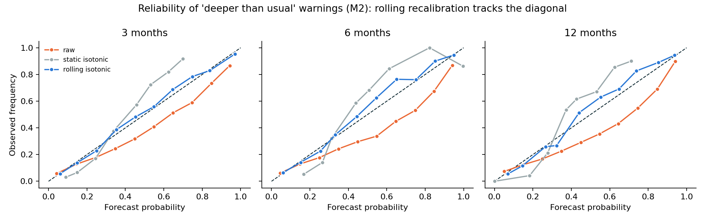
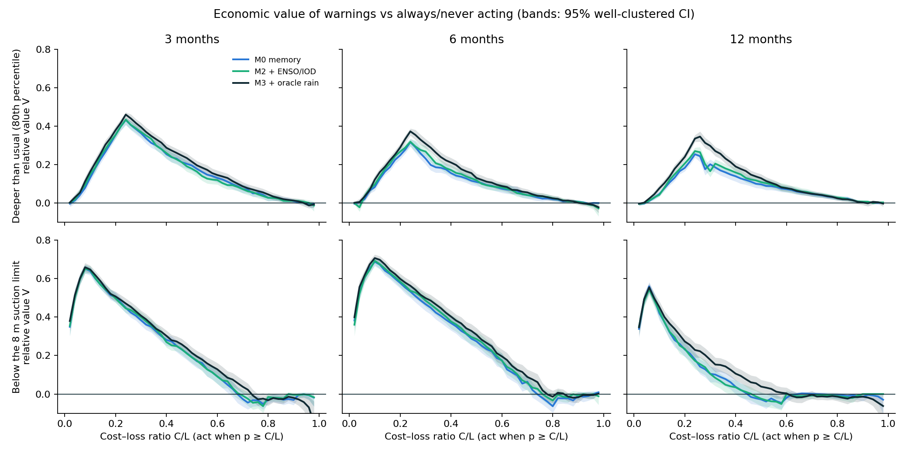
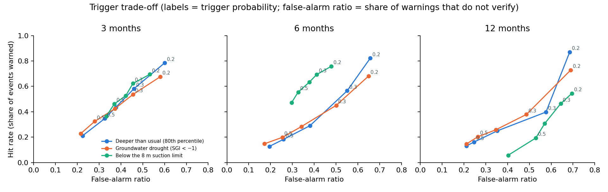

# 10 — Phase 4: Decision Value (RQ3)

**Question.** Are the calibrated forecasts worth acting on, for whom, and at what trigger? And
what would a better monsoon forecast be worth?

Reproduce (needs Phase 2 and 3 outputs):

```bash
conda activate anpr
python -m src.research.decision_value    # ~1 min
python -m src.research.decision_figures  # figures in reports/decision/
```

## 1. Design

### Events (step 4.1)
Thresholds come from each well's own readings up to 2018, separately for each season.

| Event | Definition | Test base rate (3 / 6 / 12 mo) |
|---|---|---|
| **E1 Deeper than usual** | depth > the well's 80th percentile for the target season (≥ 4 reference readings) | 0.24 / 0.24 / 0.25 |
| **E2 Groundwater drought** | standardised groundwater index (SGI) < −1: depth above the Φ(1) = 84.1 % Weibull plotting position (≥ 8 readings) | 0.19 / 0.19 / 0.19 |
| **E3 Below the suction limit** | depth > 8 m, for wells currently at ≤ 8 m. Centrifugal pumps lose suction around 7–8 m; past it farmers need submersible pumps | 0.09 / 0.10 / 0.06 |

The E1 base rate is above 0.20 because of the long-term decline: 523 wells deepen significantly, so
later years exceed thresholds set on 1994–2018 more often.

### Probabilities (step 4.2)
- **Raw:** P(y > threshold) is the share of residuals in the Phase 3 rolling depth × region pool
  with ŷ + r above the threshold. It uses only residuals observed before the forecast, and is computed
  separately for each Phase 2 arm (M0, M1, M2, M3).
- **Static isotonic** *(post hoc)*: an isotonic map fitted on 2016–18 probabilities computed
  leave-one-campaign-out.
- **Rolling isotonic** *(post hoc, primary)*: the isotonic map is refitted for each forecast on the 8
  most recent campaigns whose outcomes were known at issue time. The window was fixed before the run,
  and a unit test checks that no unobserved outcome is used.

### Value (step 4.3)
Relative economic value (Richardson 2000). A user pays C to protect against a loss L when the event
happens. Under the rule "act when p ≥ C/L":

V = (E_climate − E_forecast) / (E_climate − E_perfect)

V = 1 is a perfect forecast, V = 0 is no better than always or never acting, and V < 0 is harmful.
CIs come from a well-clustered bootstrap with 500 draws. The draws are the same for every arm, so
differences between arms are paired.

## 2. Probabilistic skill

Brier skill score vs each well's own climatological frequency, rolling-isotonic probabilities:

| Event | Arm | 3 mo | 6 mo | 12 mo |
|---|---|---|---|---|
| E1 deeper than usual | M0 memory | 0.234 | 0.155 | 0.132 |
| | M2 + ENSO/IOD | 0.234 [0.216, 0.250] | 0.165 [0.149, 0.183] | 0.143 [0.126, 0.159] |
| | M3 + oracle rain | 0.258 | 0.192 | 0.176 |
| E2 groundwater drought | M2 | 0.265 [0.239, 0.293] | 0.207 [0.181, 0.233] | 0.185 [0.158, 0.212] |
| E3 suction limit | M2 | 0.336 [0.306, 0.365] | 0.255 [0.224, 0.287] | 0.253 [0.220, 0.285] |

ROC AUC (M2): E1 0.79 / 0.74 / 0.71, E2 0.81 / 0.78 / 0.75, E3 0.91 / 0.92 / 0.86. Climatology's AUC is 0.51–0.52 for
E1 and E2. For E3 it is 0.82–0.89, because whether a well is near 8 m is already known.

### Interval calibration does not give probability calibration



- **Raw probabilities are over-confident.** Predicted 0.55 verifies 33–41 % of the time, even though the
  same pools give correct interval coverage (Phase 3). One pooled residual distribution cannot be right
  at every well-specific threshold.
- **Static recalibration over-corrects.** The map learned in 2016–18 does not transfer to 2019–25, the
  same drift as in Phase 3. Predicted 0.45 verifies 57–62 % of the time, and E1 value at 6 months drops
  from 0.33 to 0.25.
- **Rolling recalibration tracks the diagonal.** It raises Brier skill for every arm and horizon, for
  example E1 at 6 months from 0.104 to 0.165, and E3 at 12 months from 0.163 to 0.253.

## 3. Economic value



- **Warnings are worth acting on across a wide range of users.** With rolling-isotonic probabilities,
  V > 0 for cost–loss ratios from 0.02–0.06 up to 0.9–0.98 for E1 and E2. Raw probabilities lost value
  above about 0.45 and went negative at 6–12 months.
- **Peak value:**

  | Event | 3 months | 6 months | 12 months | Peak near C/L |
  |---|---|---|---|---|
  | E1 | 0.43 | 0.32 | 0.27 | ≈ the base rate (0.24) |
  | E3 | 0.65 | 0.69 | 0.54 | 0.06–0.10 |

- **Forcing adds a small value gain at 6 months only** (M2 − M0, paired 95 % CI):
  - E1 at 6 months: +0.009 to +0.037 for C/L 0.1–0.5, all CIs exclude 0.
  - E2 at 6 months: +0.016 to +0.038 for C/L 0.1–0.4.
  - At 3 and 12 months the sign changes with C/L (for example E1 at 12 months: +0.023 at 0.2, −0.036 at 0.3).

  This matches Phase 2, where forcing skill was clearest at 6 months.
- **A perfect monsoon forecast would add more** (M3 − M2): up to +0.13, with CIs excluding 0 in
  40 of 45 event × horizon × C/L cells. The largest gains are at 12 months: E1 +0.132 at C/L = 0.3, and
  E3 +0.064 to +0.072 at C/L 0.3–0.5.

## 4. Trigger recommendation (exit check)



**Rule:** issue a warning when the rolling-isotonic probability is at least the user's cost–loss ratio.
With reliable probabilities this rule is optimal for every user. When a user's C/L is unknown, use these
defaults (M2):

| Use | Event, horizon | Trigger | Warnings issued | Hit rate | False-alarm rate | False-alarm ratio | Value at C/L = trigger [95 % CI] |
|---|---|---|---|---|---|---|---|
| Seasonal planning (crop choice, pumping schedules) | E1, 3 months | **p ≥ 0.3** | 26 % of forecasts | 58 % | 16 % | 46 % | 0.37 [0.34, 0.39] |
| | E1, 6 months | p ≥ 0.3 | 31 % | 57 % | 22 % | 55 % | 0.27 [0.24, 0.30] |
| Pump replacement / deepening ahead of the dry season | E3, 6 months | **p ≥ 0.2** | 15 % | 76 % | 8 % | 48 % | 0.58 [0.56, 0.61] |
| | E3, 3 months | p ≥ 0.2 | 13 % | 70 % | 8 % | 53 % | 0.50 [0.47, 0.52] |
| Drought declaration support | E2, 6 months | p ≥ 0.2 | 36 % | 68 % | 29 % | 65 % | 0.37 [0.33, 0.40] |

Twelve-month E3 warnings are weak: V = 0.24 at 0.2, negative above 0.45. They should not be used for
pump decisions a year ahead.

**Exit check (Phase 4): met.** Value curves with CIs exist for every arm, event and horizon, and a trigger
rule is stated with its expected hit and false-alarm rates.

## 5. Case study: the 2023–24 dry year (step 4.4)

This is a state-level case study. Official sources give only state-wise counts for the Atal Bhujal
Yojana (80 districts in Gujarat, Haryana, Karnataka, Madhya Pradesh, Maharashtra, Rajasthan and Uttar
Pradesh), so the district filter waits for the official list. Wells were tagged to states with
geoBoundaries ADM1 (ODbL; 6 427 of 6 438 wells tagged, 11 lie outside India's polygons).

E1 at 3 months, M2, trigger 0.3. Targets run from August to the following May.

| Water year (all-India JJAS) | Area | Readings | Event rate | Mean warning probability | Hit rate | False-alarm ratio |
|---|---|---|---|---|---|---|
| 2022–23 (wet, +9 %) | Atal Bhujal states | 3 393 | 0.17 | 0.16 | 0.42 | 0.46 |
| | Other states | 2 975 | 0.27 | 0.21 | 0.50 | 0.38 |
| 2023–24 (dry, −5 %) | Atal Bhujal states | 552 | **0.25** | **0.17** | 0.38 | 0.33 |
| | Other states | 531 | 0.26 | 0.21 | 0.44 | 0.47 |

When the monsoon turned dry, exceedances in Atal Bhujal states rose from 17 % to 25 %, but the mean
warning probability barely moved (0.16 → 0.17). The forecasts lagged the change of regime, which a
seasonal monsoon forecast would address (§3, oracle). Caveat: 2023–24 has about a sixth of the
2022–23 readings because many manual records end in 2023.

## 6. Plain-language advisory (step 4.5)

A template turns each forecast record into text. Every number is copied from the record, and a unit
test checks that the numbers in the text match. Example (`reports/decision/advisory_examples.json`):

> Well 265145080553501, forecast for January 2020: water about 30.9 m below ground (80% range
> 28.0–34.3 m). Chance it is deeper than this well's usual level for the season (25.0 m): 77%.
> Warning: plan for a deeper-than-usual water level.

The LLM-generated variant listed in the plan was not built. It needs a faithfulness audit and adds
nothing the paper's claims depend on, so it is deferred to an appendix if a reviewer asks.

## 7. Answer to RQ3

1. **The warnings have real economic value.** For "deeper than usual" at 3 months, a user acting on them
   saves up to 43 % of the gap between climatology and a perfect forecast; for the 8 m suction-limit
   event, up to 65–69 % at 3–6 months.
2. **That value depends on calibrated probabilities, not just calibrated intervals.** Raw probabilities
   lose value for cost–loss ratios above about 0.45. A rolling recalibration restores value across
   almost the whole range; a static one makes it worse.
3. **Observed monsoon forcing adds decision value only at 6 months, and only a little** (+0.01 to +0.04).
   A perfect monsoon forecast would add up to 0.13. Most of today's value comes from groundwater
   memory, and the next gain has to come from better seasonal rainfall forecasts.
4. **Recommended rule:** warn when p ≥ C/L. As defaults, use 0.3 for seasonal planning and 0.2 for pump
   decisions six months ahead.

## 8. Artefacts

| File | Content |
|---|---|
| `src/research/decision_value.py` | Events, probabilities (raw / static / rolling), value, triggers, case study, advisory |
| `src/research/decision_figures.py` | Three figures |
| `src/research/states.py` | State tags from geoBoundaries ADM1 |
| `tests/research/test_decision_value.py` | 6 tests: value formula, contingency, plotting position, no look-ahead, advisory faithfulness, rolling recalibration |
| `reports/decision/scores.json` | Brier, BSS with CI, AUC per arm × event × horizon × probability variant |
| `reports/decision/value_curves.csv` | V(C/L) with CIs and the optimal-trigger envelope |
| `reports/decision/value_differences.csv` | Paired M2 − M0 and M3 − M2 value differences |
| `reports/decision/triggers.csv` | Contingency tables for triggers 0.2–0.6 |
| `reports/decision/case_study_2023.csv` | Wet vs dry water year, Atal Bhujal states vs the rest |
| `reports/decision/advisory_examples.json` | Template advisories with their source records |
